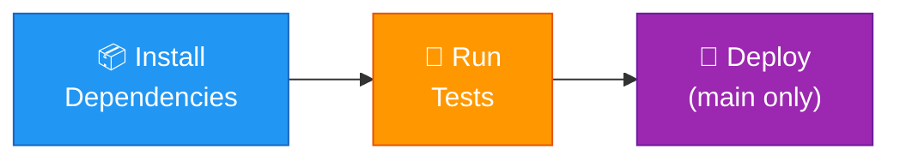

# AirPass — CI/CD Pipeline Documentation 🚀

> **Course**: Agile DevOps | **Semester**: 7 | **University**: PDEU

This document explains the complete CI/CD (Continuous Integration / Continuous Deployment) pipeline built for the AirPass project using **GitHub Actions** and standard DevOps best practices.

---

## 📋 Table of Contents

1. [Project Overview](#project-overview)
2. [Repository Structure](#repository-structure)
3. [CI/CD Pipeline Flow](#cicd-pipeline-flow)
4. [Pipeline Stages Explained](#pipeline-stages-explained)
5. [How to Use](#how-to-use)
6. [Configuration Files Reference](#configuration-files-reference)
7. [Branching Strategy](#branching-strategy)

---

## Project Overview

**AirPass** is a Node.js/Express web application for secure, temporary file sharing. The CI/CD pipeline automates:

| What | Why |
|------|-----|
| Dependency installation | Ensures consistent, reproducible builds |
| Automated testing | Catches bugs before they reach production |
| Deployment simulation | Demonstrates production deploy flow |

---

## Repository Structure

```
AirPass-main/
├── .github/
│   └── workflows/
│       └── ci-cd.yml              ← Main CI/CD pipeline (3 stages)
├── tests/
│   └── health.test.js             ← Automated health check test
├── public/                        ← Frontend static files
├── server.js                      ← Express server (main application)
├── start.js                       ← Server entry point
├── package.json                   ← Dependencies & scripts
├── package-lock.json              ← Locked dependency versions
├── .gitignore                     ← Files excluded from Git
├── .env.example                   ← Environment variable template
├── vercel.json                    ← Vercel deployment config
└── CICD.md                        ← This documentation file
```

---

## CI/CD Pipeline Flow

The pipeline triggers automatically on code changes and runs through 3 sequential stages:



### Trigger Conditions

| Event | Branches | What Runs |
|-------|----------|-----------|
| `push` | `main`, `develop` | All 3 stages (deploy only on `main`) |
| `pull_request` | `main` | Stages 1–2 (no deploy) |

---

## Pipeline Stages Explained

### Stage 1: 📦 Install Dependencies

```
Job: install → runs-on: ubuntu-latest
```

**What it does:**
1. Checks out the repository code
2. Sets up Node.js v18
3. Runs `npm ci` (clean install — uses `package-lock.json` for exact versions)
4. Caches `node_modules/` for use by later stages

**Why `npm ci` instead of `npm install`?**
- `npm ci` is faster in CI environments
- It always installs exact versions from `package-lock.json`
- It fails if `package-lock.json` is out of sync — catching potential issues

---

### Stage 2: 🧪 Run Tests

```
Job: test → needs: install → runs-on: ubuntu-latest
```

**What it does:**
1. Restores the cached `node_modules/` from Stage 1
2. Runs `npm test` which executes `node tests/health.test.js`

**What the test verifies:**
- ✅ The Express server starts successfully
- ✅ `GET /api/health` returns HTTP `200 OK`
- ✅ Response body is `{"status": "ok"}`
- ✅ The server shuts down cleanly without errors

**If tests fail:** The pipeline stops here — no deploy happens.

---

### Stage 3: 🚀 Deploy

```
Job: deploy → needs: test → runs-on: ubuntu-latest
Condition: only on push to main branch
```

**What it does:**
- Currently runs a **deployment simulation** (prints deployment info)
- Shows the commit SHA and branch being deployed
- Provides instructions for connecting real deployment targets

**Real deployment options (replace the simulation step with):**

| Platform | Command |
|----------|---------|
| **Vercel** | `npx vercel --prod --token $VERCEL_TOKEN` |
| **SSH Server** | `ssh user@server 'cd /app && git pull && npm ci && pm2 restart'` |

---

## How to Use

### Prerequisites
- GitHub account
- Git installed locally
- Node.js v18+ (for local development)

### Step-by-Step: Push to GitHub and Trigger Pipeline

```bash
# 1. Initialize Git repository (if not already)
git init

# 2. Add all files
git add .

# 3. Create initial commit
git commit -m "Initial commit: AirPass with CI/CD pipeline"

# 4. Create GitHub repo and add remote
git remote add origin https://github.com/YOUR_USERNAME/AirPass.git

# 5. Push to main branch
git branch -M main
git push -u origin main
```

Once pushed, go to your GitHub repository → **Actions** tab to see the pipeline running!

### Step-by-Step: Local Development

```bash
# Install dependencies
npm install

# Run in development mode (with auto-reload)
npm run dev

# Run tests
npm test

# Start in production mode
npm start
```

---

## Configuration Files Reference

### `.github/workflows/ci-cd.yml`
The main CI/CD pipeline with 3 stages. Triggers on push to `main`/`develop` and PRs to `main`.

### `.gitignore`
Excludes `node_modules/`, environment secrets (`.env`), OS junk files, IDE configs, build outputs, and temporary files. Keeps `.env.example` for reference.

### `.env.example`
Template showing required environment variables:
```
PORT=5000
NODE_ENV=production
```

### `tests/health.test.js`
Automated test that verifies the server starts and the `/api/health` endpoint responds correctly. Uses only Node.js built-in modules (`http`, `assert`) — no external test framework required.

---

## Branching Strategy

The pipeline follows a simplified **GitFlow** approach:


| Branch | Purpose | Pipeline Behavior |
|--------|---------|-------------------|
| `feature/*` | New features, bug fixes | No pipeline (create PR to trigger) |
| `develop` | Integration branch | Runs Install → Test |
| `main` | Production-ready code | Runs all 3 stages including Deploy |

### Workflow

1. Create a `feature/xyz` branch from `develop`
2. Make changes, commit, and push
3. Open a **Pull Request** to `develop` — pipeline runs tests
4. Merge to `develop` — pipeline runs again on the integration branch
5. When ready for production, PR from `develop` → `main`
6. Merge to `main` — full pipeline including deploy

---

## 📊 Pipeline Summary

```
┌─────────────────────────────────────────────────────────┐
│                  AirPass CI/CD Pipeline                  │
├─────────────────┬───────────────────┬───────────────────┤
│  📦 Install      │   🧪 Test          │  🚀 Deploy        │
│                 │                   │  (main only)      │
├─────────────────┼───────────────────┼───────────────────┤
│ checkout        │ checkout          │ checkout          │
│ setup node 18   │ setup node 18     │ deploy step       │
│ npm ci          │ restore cache     │ (simulation)      │
│ cache deps      │ npm test          │                   │
└─────────────────┴───────────────────┴───────────────────┘
        │                  │                  │
        ▼                  ▼                  ▼
     ~30 sec            ~15 sec            ~5 sec
```

> **Total pipeline time:** ~1 minute (approximate)

---

## ❓ FAQ

**Q: Why GitHub Actions and not Jenkins/GitLab CI?**
A: GitHub Actions is free for public repos, tightly integrated with GitHub, and requires zero infrastructure setup — perfect for college projects.

**Q: Why is the deploy stage a simulation?**
A: To keep the pipeline self-contained without requiring external credentials. Replace the simulation step with your actual deployment commands when ready.

**Q: How do I add more tests?**
A: Add more test logic in `tests/health.test.js` or create additional test files and update the `test` script in `package.json`.

---

*Generated for PDEU Agile DevOps Lab — Semester 7*
